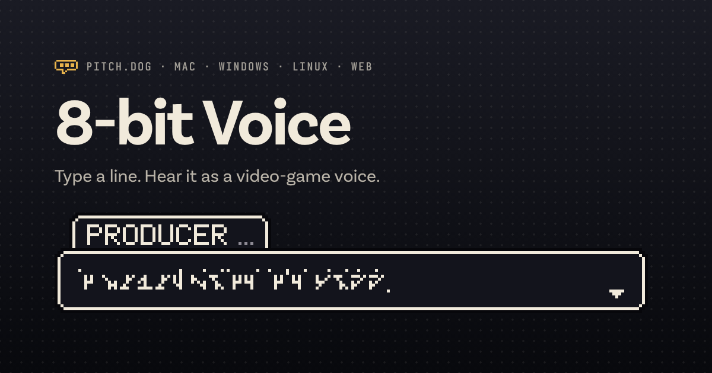

# 8-bit Voice

Type a line and hear it as a video-game voice. The words come out as gibberish, but the rhythm, the melody and the attitude survive, so whoever answers can tell the audience what was said.

**[Open it in your browser](https://bomkino.github.io/8bit-Voice/)** · **[Download the app](https://github.com/bomkino/8bit-Voice/releases/latest)**



Every sound is synthesized on your device from square, triangle and wavetable oscillators, formant filters and noise. There are no samples, so there is nothing to license, and the clips are yours. The same line, voice and take always give the same clip, sample for sample.

[pitch.dog](https://pitch.dog) made it for the 8-bit callers in Typecast, and it's free and open source under the MIT License.

## Get it

| Where | How |
| --- | --- |
| iPhone and iPad | Open [the web app](https://bomkino.github.io/8bit-Voice/) in Safari, tap **Share**, then **Add to Home Screen**. It opens full screen and works offline. |
| Android | Open [the web app](https://bomkino.github.io/8bit-Voice/) in Chrome and tap **Install** (or **Add to Home screen** in the menu). |
| Mac with Apple silicon | [`8-bit-Voice-mac-arm64.dmg`](https://github.com/bomkino/8bit-Voice/releases/latest/download/8-bit-Voice-mac-arm64.dmg) |
| Mac with an Intel chip | [`8-bit-Voice-mac-x64.dmg`](https://github.com/bomkino/8bit-Voice/releases/latest/download/8-bit-Voice-mac-x64.dmg) |
| Windows 10 or 11 | [`8-bit-Voice-windows-x64-setup.exe`](https://github.com/bomkino/8bit-Voice/releases/latest/download/8-bit-Voice-windows-x64-setup.exe) ([Arm](https://github.com/bomkino/8bit-Voice/releases/latest/download/8-bit-Voice-windows-arm64-setup.exe)) |
| Linux, any distro | [`8-bit-Voice-linux-x86_64.AppImage`](https://github.com/bomkino/8bit-Voice/releases/latest/download/8-bit-Voice-linux-x86_64.AppImage) ([Arm](https://github.com/bomkino/8bit-Voice/releases/latest/download/8-bit-Voice-linux-arm64.AppImage)) |
| Debian and Ubuntu | [`8-bit-Voice-linux-amd64.deb`](https://github.com/bomkino/8bit-Voice/releases/latest/download/8-bit-Voice-linux-amd64.deb) ([Arm](https://github.com/bomkino/8bit-Voice/releases/latest/download/8-bit-Voice-linux-arm64.deb)) |

The macOS, Windows and Linux apps are the same tool in their own window, with menus and save dialogs. Nothing in them talks to the network.

### Opening it the first time

The apps aren't signed with an Apple or Microsoft developer certificate yet, so each system asks once before it opens one.

- **macOS (12 or later).** Open the .dmg and drag 8-bit Voice to Applications. The first time you open it, macOS says it can't verify the app: click **Done**. Then go to **System Settings › Privacy & Security**, scroll down and click **Open Anyway** next to 8-bit Voice. After that it opens normally. In Terminal, `xattr -dr com.apple.quarantine "/Applications/8-bit Voice.app"` does the same thing. From then on the app updates itself (**8-bit Voice › Check for Updates…**), the same way pitch.dog's other Mac apps do: [docs/UPDATES.md](docs/UPDATES.md).
- **Windows.** If SmartScreen says "Windows protected your PC", click **More info**, then **Run anyway**. The installer puts 8-bit Voice in your Start menu. No admin rights are needed.
- **Linux.** For the AppImage, run `chmod +x 8-bit-Voice-linux-x86_64.AppImage` and open it. Some distros need `libfuse2` first. For the .deb, run `sudo apt install ./8-bit-Voice-linux-amd64.deb`, then find it in your app menu.

`SHA256SUMS.txt` on each release has a checksum for every file.

## Using it

1. Type the lines, one per clip, or open a `.txt` file (you can also drop one on the box). The two Typecast episodes are there as examples.
2. Pick a caller or a machine. The round button on each machine plays the current line in it, and **Hear all six** plays them back to back.
3. Tune it: pitch, speed, melody, the machine's own character knob, and grit. **Speakerphone** puts it through a phone speaker. **New take** gives a slightly different performance of the same settings.
4. Save one line or all of them: 48 kHz, 16-bit mono WAV. On a computer, **Download all** gives you a zip with `voice.json`, the settings to make the same clips again. On a phone, it opens the share sheet so you can send each WAV to Files, AirDrop or an editing app.

Space plays and stops, and Ctrl Enter (⌘ Return on a Mac) plays the line you're typing.

### Delivery

Stage directions go in brackets before the line, and they combine: `(slow, awed) ...That's the future.` "Very" pushes one further: `(panicking, very fast and very high)`. The delivery buttons add and remove them for you.

whisper · quiet · shouting · slow · fast · faster and faster · high · low · flat · excited · awed · sad · offended · panicking

Punctuation does the rest. A question rises, a full stop falls, an ellipsis trails off, a dash cuts the line off mid-syllable, and capitals are louder. `(speakerphone)` puts one line on the phone. A `PRODUCER:` label in front of a line names the box.

### Machines

| Machine | Sounds like | Character knob |
| --- | --- | --- |
| Square | NES square wave | Bite: pure blips to hissy consonants |
| Pocket | Game Boy wave channel | Nasal: round to pinched |
| Babble | Animal Crossing-style chatter | Squeak: big animal to tiny one |
| Typewriter | Undertale-style text blips | Click: soft boop to sharp tick |
| Boss | Final-boss voice | Menace: stern to demon with reverb |
| Speech chip | 80s arcade speech chip | Buzz: clean robot to cheap toy |

Each caller preset picks a machine and dials it in. The heist producer is a clipped Square, and the space director is the Speech chip.

### The dialogue box

The preview shows the line in a pixel dialogue box. The words appear in a made-up rune alphabet where each letter always gets the same glyph, so it reads like a real language nobody speaks, while the punctuation stays readable. **Words** swaps the runes for the real words in pixel capitals.

## Command line

The same engine runs in Node 18 or later, with nothing to install:

```sh
node cli.mjs "(offended) I never said I'd call." --voice heist-producer --phone --out line.wav
node cli.mjs --file lines.txt --voice space-director --phone --dir clips --speaker Director
node cli.mjs --file lines.txt --compare --dir compare --lineup compare/all.wav
node cli.mjs --in me.wav --voice robot --out robot.wav
node cli.mjs --list
```

`--in` says a recording again in the voice instead of speaking a line: a 16-bit, 24-bit or float WAV, mono or stereo. Every knob works on it, and a line given with it is what the dialogue box types and `--json` lists.

`--json` writes each clip's timing next to its WAV: every syllable's start, length and pitch, and the characters it voices, for syncing animation to it. The app's **Make it from the command line** panel gives you the exact command for the line and voice on screen. `node stings.mjs` makes the little game-over sting.

## In your own code

`chipvoice.js` has no dependencies. It works as a `<script>` (as `window.ChipVoice`), with `require()`, and in a bundler. `chipvoice.d.ts` types it.

```js
const fs = require('node:fs');
const CV = require('./chipvoice.js');
const clip = CV.render('(excited) We got the vault!', CV.normVoice({ style: 'babble', phone: true }));
fs.writeFileSync('vault.wav', CV.encodeWav(clip.samples, clip.sampleRate));
```

A recording works the same way. `analyzeRecording` takes mono samples at any rate and listens once; `renderRecording` says it again in any voice and returns the same shape as `render`. The Mouth keeps the words, with Clarity running from almost clear down to cheerful gibberish. Every other machine turns the person's syllables, rhythm and melody into its own blips.

```js
const rec = CV.analyzeRecording(samples, 44100);
const robot = CV.renderRecording(rec, 'robot', { text: 'What I said, for the dialogue box' });
```

## Working on it

```sh
npm test                 # the engine's tests
npm start                # the web app at http://localhost:8080

cd desktop
npm ci
npm start                # the desktop app, from source
npm run dist:mac         # .dmg and .zip, Apple silicon and Intel, with Sparkle (on a Mac)
npm run test:update      # proves a Mac copy updates itself (on a Mac, after dist:mac)
npm run dist:win         # installers for x64 and Arm (on Windows)
npm run dist:linux       # AppImage and .deb, x64 and Arm
```

Building the Mac app off a Mac needs [rcodesign](https://github.com/indygreg/apple-platform-rs) for its ad-hoc signature, because Apple silicon won't run unsigned code: `RCODESIGN=/path/to/rcodesign npm run dist:mac-off-mac`.

- `index.html` is the whole web app. The desktop apps load the same page, so a change there reaches every platform.
- `sw.js` and `manifest.webmanifest` make it installable and offline.
- `desktop/` is the Electron wrapper. Its `build/make_icon.py` draws every icon and the disk image background, and `build/social.html` renders `icons/social.png`.
- `desktop/build/sparkle.sh`, `desktop/native/sparkle/` and `desktop/build/sign-update.sh` are the Mac app's updater: [docs/UPDATES.md](docs/UPDATES.md).
- `.github/workflows/build.yml` tests the engine, builds and opens the apps on macOS, Windows and Linux, and tests the Mac updater, for every pull request. On `main`, when `desktop/package.json` has a new version, it publishes them as a release with signed update feeds.
- `.github/workflows/pages.yml` puts the web app on GitHub Pages from `main`.

To ship a new version, raise `version` in `desktop/package.json` (and `APP_VERSION` in `index.html`, the cache name in `sw.js` and `version` in `package.json` to match), add a section to `CHANGELOG.md`, then merge to `main`.

Issues and pull requests are welcome.

## License

The code is under the [MIT License](LICENSE). The fonts in `fonts/` are pitch.dog's PD Body and PD Eyebrow, dedicated to the public domain under [CC0](fonts/LICENSE.md). The pitch.dog name and marks aren't covered by either license.
